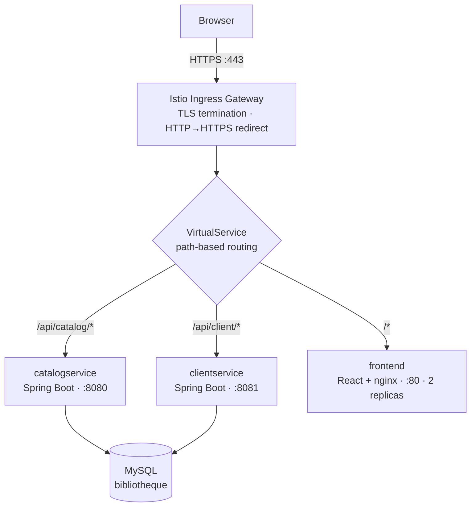

# Bibliothèque — A Microservices Reading-List Platform on Kubernetes

A distributed book catalogue and personal reading-list application, built as three
independently deployable services and released to Kubernetes behind an **Istio**
service mesh with TLS termination and path-based routing.

> **Stack:** React 18 · Spring Boot 3 (Java 17) · MySQL · Docker · Kubernetes · Istio · GitHub Actions

---

## Contents

- [Architecture](#architecture)
- [Tech stack](#tech-stack)
- [Features](#features)
- [Repository layout](#repository-layout)
- [API reference](#api-reference)
- [Running locally](#running-locally)
- [Deploying to Kubernetes](#deploying-to-kubernetes)
- [Configuration](#configuration)
- [Continuous integration](#continuous-integration)
- [Known limitations & roadmap](#known-limitations--roadmap)

---

## Architecture

Three services are deployed independently. All external traffic enters through the
Istio ingress gateway, which terminates TLS and routes by URL prefix — the browser
only ever talks to a single origin, so the front-end needs no CORS handling and no
knowledge of where the back-ends live.



**Routing rules** (`deployment.yaml`, `VirtualService`):

| Incoming path | Rewritten to | Destination |
| --- | --- | --- |
| `/api/catalog/…` | `/…` | `catalogservice:8080` |
| `/api/client/…` | `/…` | `clientservice:8081` |
| anything else | — | `frontend:80` |
| any `:80` request | — | 301 → `:443` |

**Service split.** `catalog-service` is read-only and owns book discovery; it can be
scaled and cached independently of writes. `client-service` owns identity and the
user↔book relationship. Both read the same schema, which keeps the boundary simple at
the cost of a shared database (see [limitations](#known-limitations--roadmap)).

---

## Tech stack

| Layer | Technology |
| --- | --- |
| Front-end | React 18, React Router 7, MUI 6, Bootstrap 5, Axios |
| Services | Spring Boot 3.4, Java 17, Spring Data JPA, Lombok, Gradle |
| Database | MySQL 8 |
| Containers | Docker — multi-stage build for the front-end (Node 20 → nginx:alpine) |
| Orchestration | Kubernetes — Deployments, ClusterIP Services, resource requests |
| Mesh / ingress | Istio — Gateway, VirtualService, TLS via Kubernetes secret |
| CI | GitHub Actions — three parallel jobs on every pull request |

---

## Features

- Browse and full-text search a book catalogue, with pagination
- View a book's details and author
- Register and log in
- Add books to a personal list, mark them as read, rate them 0–10
- Zero-CORS single-origin delivery: the SPA and both APIs share one hostname
- Horizontal scaling per service — the front-end runs 2 replicas, back-ends 1 each

---

## Repository layout

```
.
├── .github/workflows/actions.yml   # CI: build + containerize all three services
├── catalog-service/                # Spring Boot — book catalogue (read-only)
│   ├── src/main/java/…/controller/  BookController
│   ├── src/main/java/…/data/        Book, User, UserBook, UserBookId
│   ├── src/main/java/…/repository/  Spring Data JPA repositories
│   └── Dockerfile
├── client-service/                 # Spring Boot — auth, users, reading lists
│   ├── src/main/java/…/controller/  AuthController, UserController, UserBookController
│   ├── src/main/java/…/dto/         LoginRequest, UserBookDTO
│   └── Dockerfile
├── front-end/                      # React SPA
│   ├── src/                         Home, Browse, Result, List, Login, Register, Author…
│   └── Dockerfile                   multi-stage → nginx
└── deployment.yaml                 # Deployments, Services, Istio Gateway + VirtualService
```

---

## API reference

All paths are relative to the gateway prefix shown in the routing table above.

### catalog-service — `/api/catalog`

| Method | Path | Description |
| --- | --- | --- |
| `GET` | `/books` | Paginated list of books |
| `GET` | `/books/search?query={q}` | Full-text search across the catalogue |
| `GET` | `/books/{id}` | Single book by id |

### client-service — `/api/client`

| Method | Path | Description |
| --- | --- | --- |
| `POST` | `/auth/login` | Authenticate; body `{ "email", "password" }` |
| `GET` | `/users/{userId}/books` | The user's reading list, with book details |
| `POST` | `/users/{userId}/books/{bookId}` | Add a book to the user's list |
| `PUT` | `/users/{userId}/books/{bookId}/mark-read` | Mark as read |
| `PUT` | `/users/{userId}/books/{bookId}/rate/{rating}` | Rate 0–10 |

---

## Running locally

**Prerequisites:** JDK 17, Node 20, Docker, and a reachable MySQL 8 instance holding
the `bibliotheque` schema.

```bash
# 1. Back-end services (one terminal each)
cd catalog-service && ./gradlew bootRun     # :8080
cd client-service  && ./gradlew bootRun     # :8081

# 2. Front-end
cd front-end && npm install && npm start    # :3000
```

Point the services at your database with environment variables rather than editing
the properties files (see [Configuration](#configuration)).

Or build the containers exactly as CI does:

```bash
cd catalog-service && ./gradlew build && docker build -t catalogservice .
docker run -d -p 8080:8080 catalogservice
```

---

## Deploying to Kubernetes

**Prerequisites:** a cluster with Istio installed and injection enabled, plus a TLS
secret named `progdistmaher-secret` in the `istio-system` namespace.

```bash
# Label the namespace so Istio injects sidecars
kubectl label namespace default istio-injection=enabled

# Create the TLS secret used by the Gateway
kubectl create -n istio-system secret tls progdistmaher-secret \
  --key=privkey.pem --cert=fullchain.pem

# Deploy everything
kubectl apply -f deployment.yaml

# Verify
kubectl get pods,svc
kubectl get gateway,virtualservice
kubectl get svc istio-ingressgateway -n istio-system   # → external IP for your DNS A record
```

Point your domain's A record at the ingress gateway's external IP. The `Gateway`
is configured for `progdistmaher.works`; change the `hosts` entries in
`deployment.yaml` to your own domain.

---

## Configuration

Spring Boot maps environment variables onto properties, so no code change is needed
to point a service at a different database:

| Variable | Purpose |
| --- | --- |
| `SPRING_DATASOURCE_URL` | JDBC URL, e.g. `jdbc:mysql://host:3306/bibliotheque` |
| `SPRING_DATASOURCE_USERNAME` | Database user |
| `SPRING_DATASOURCE_PASSWORD` | Database password |
| `SERVER_PORT` | Listen port (defaults: 8080 catalog, 8081 client) |

In Kubernetes, supply these from a `Secret` rather than inline in the manifest:

```bash
kubectl create secret generic db-credentials \
  --from-literal=username=<user> \
  --from-literal=password=<password>
```

```yaml
env:
  - name: SPRING_DATASOURCE_USERNAME
    valueFrom:
      secretKeyRef: { name: db-credentials, key: username }
  - name: SPRING_DATASOURCE_PASSWORD
    valueFrom:
      secretKeyRef: { name: db-credentials, key: password }
```

---

## Continuous integration

`.github/workflows/actions.yml` runs on every pull request, with three jobs in
parallel:

| Job | Steps |
| --- | --- |
| Build Catalog Service | JDK 17 → `./gradlew build` (compiles + JUnit) → `docker build` → smoke-run container |
| Build Client Service | same, on port 8081 |
| Build Front-End | Node 20 → `npm install` → `npm run build` → `docker build` → smoke-run |

A failing compile, test, or image build blocks the merge.

---

## Known limitations & roadmap

Honest notes on what this project does *not* yet do well:

- **Shared database.** Both services read the same schema, so they are not truly
  independently deployable. Splitting the schema, or moving `catalog` behind its own
  store, is the natural next step.
- **Authentication is session-less.** `POST /auth/login` returns a user id rather than
  a signed token; endpoints under `/users/{userId}/…` trust the id in the path. Issuing
  a JWT and validating it (ideally at the mesh layer) is required before this is safe.
- **Password hashing is unsalted SHA-256.** Should be bcrypt or Argon2 via Spring
  Security's `PasswordEncoder`.
- **`GET /books` hard-codes a page offset** (`PageRequest.of(2, 30)`), a leftover from
  development — pagination parameters should come from the request.
- **CORS is `origins = "*"`** on the controllers. Unnecessary now that everything is
  served from one origin through the gateway, and it should be removed.
- **CI has no CD.** The workflow builds images but never pushes them or applies the
  manifests; deployment is manual. Adding a push-to-registry and `kubectl apply` job on
  `main` would close the loop.
- **No liveness or readiness probes**, and no `limits` alongside the resource
  `requests`, so Kubernetes cannot restart a wedged pod or protect its neighbours.
